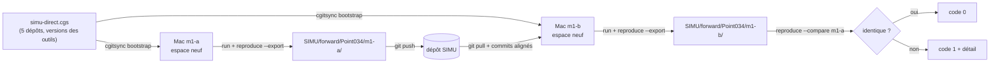

# Expérience SIMU : documents, installation par ComplexGitSync et protocole de comparaison

*État au 2026-11-09, twin direct 0.9.0-alpha.2, ComplexGitSync 8.6.2.*

> Les scripts et documents cités au §1 (`1_installer_mac.sh`, `TUTO_SIMU.md`…) ne sont pas dans ce dépôt : ils vivent dans le dossier local `docs/simu/` de MOLONARI1D et se transmettent en zip. Ce dépôt ne contient que les exports `forward/Point034/<MACHINE>/`.

L'expérience SIMU vérifie une chose : un operating space MOLONARI remonté de zéro sur une autre machine redonne le même calcul, **au bit près**. Le calcul testé est le twin direct du point Point034. Deux Mac M1 le calculent chacun dans un espace neuf monté par ComplexGitSync. Chaque Mac dépose son export dans le dépôt [KeanuToofa/SIMU](https://github.com/KeanuToofa/SIMU), et le second compare son résultat à celui du premier.

- **Ce que l'expérience prouve :** deux machines de même architecture (Apple Silicon) donnent le même calcul au bit près.
- **Ce qu'elle ne prouve pas :** la reproduction entre un Mac ARM et un Linux x86-64. Ce point reste ouvert.
- **Valeurs attendues pour Point034 :** `water_flux_mean = -4.524782784649976e-07`, `rmse_total = 0.11620092968527289`.
- **Durées mesurées :** montage 72 s, calcul et comparaison 52 s.



## 1. Les documents du dossier `docs/simu/`

Le dossier est local, hors git (`docs/` n'est pas suivi). Pour le passer à un autre Mac : `cd docs && zip -r simu.zip simu`.

| Fichier | Rôle | Quand s'en servir |
|---|---|---|
| `README.md` | Les trois commandes, le résultat attendu, les conditions | Point d'entrée rapide |
| `README_EXPLICATIF.md` | Ce document : pourquoi et comment ça marche | Pour comprendre ou présenter l'expérience |
| `TUTO_SIMU.md` | Le protocole détaillé à la main, avec le dépannage | Quand un script échoue |
| `1_installer_mac.sh` | Installe git (configuré), pixi 0.81.0, gh et ComplexGitSync 8.6.2 | Une fois par Mac |
| `2_monter_et_lancer.sh` | Télécharge `simu-direct.cgs`, monte l'espace, aligne les commits, lance le calcul | À chaque exécution |
| `3_aligner_commits.sh` | Replace l'espace sur les commits de la machine déjà présente dans SIMU | Appelé par le script 2 |
| `simu_acces/collaborateurs.txt` | Identifiants GitHub des personnes à inviter dans SIMU | Côté propriétaire |
| `simu_acces/ajouter_collaborateurs.sh` | Envoie les invitations (`--dry-run`, `--statut`, `--retirer`) | Côté propriétaire |
| `reference/simu-direct.cgs` | Copie du manifeste de montage | Lecture seule |
| `reference/simu_direct.sh` | Copie du script de calcul, d'export et de comparaison | Lecture seule |
| `reference/t11.md`, `reference/PR_t11.md` | Plan et description de PR du lot T11 qui a créé tout cela | Historique |

Les copies de `reference/` datent du 2026-11-09. Les scripts utilisent toujours les versions de la branche `CGS-MOLO` (la racine de MOLONARI1D et `scripts/simu_direct.sh`), jamais ces copies.

## 2. Pourquoi ComplexGitSync est central

MOLONARI n'est pas un dépôt, mais cinq dépôts emboîtés : le code, l'API et le backend, les données, les twins, et SIMU. Un calcul n'est reproductible que si les cinq sont aux bons chemins et aux bons commits, avec les bonnes versions d'outils. ComplexGitSync (`cgitsync`) traite cet ensemble comme une seule unité, un *operating space*.

| Besoin de l'expérience | Sans ComplexGitSync | Avec ComplexGitSync |
|---|---|---|
| Avoir les 5 dépôts au bon endroit | 5 `git clone` à la main, chemins à deviner | Un seul fichier `simu-direct.cgs` les décrit ; `bootstrap` les place |
| Mêmes versions d'outils sur les deux Mac | Rien ne le vérifie | `[environment]` impose git 2.39, uv 0.9 et pixi 0.81 |
| Savoir à quel état exact on a calculé | À reconstituer après coup | État `.gts` enregistré (commit de chaque dépôt), haché dans l'empreinte de l'export |
| Décrire l'environnement d'une machine | À la main | `cgitsync env show`, écrit dans `environment.txt` de l'export |
| Repartir d'un espace neuf | Supprimer, recloner, risquer un oubli | Un nouveau `bootstrap` sous un autre nom, environ 70 s |

Sans cet outil, une différence entre deux machines pourrait venir d'un dépôt mal placé, d'une mauvaise branche ou d'un outil d'une autre version. L'expérience ne prouverait alors rien. Avec lui, la seule chose qui change entre les deux espaces est la machine : c'est exactement ce qu'on veut tester.

Le manifeste complet, `simu-direct.cgs` :

```toml
project = { name = "MOLONARI1D", default_branch = "CGS-MOLO" }
repos = [
    { repository = "github:flipoyo/MOLONARI1D", fallback_branch = "CGS-MOLO" },
    { repository = "github:flipoyo/MOLONARI-API", relative_path = "Molonaviz" },
    { repository = "github:flipoyo/MOLONARI-data", relative_path = "data" },
    { repository = "github:KeanuToofa/MOLONARI-TWIN", relative_path = "MOLONARI-TWIN" },
    { repository = "github:KeanuToofa/SIMU", relative_path = "SIMU" },
]

[environment]
tools = { git = "2.39", uv = "0.9", pixi = "0.81" }
```

## 3. Installation pas à pas (une fois par Mac)

```bash
cd docs/simu
bash 1_installer_mac.sh          # ajouter --ssh si l'accès GitHub se fait par clé SSH
```

Le script ne touche pas à ce qui est déjà en place. Il fait, dans l'ordre :

1. **Machine.** Refuse tout ce qui n'est pas un Mac Apple Silicon (`Darwin arm64`). `jaxlib` 0.11.2, figé par le verrou, n'a pas de paquet pour Mac Intel.
2. **git.** Vérifie sa présence et configure le nom et l'e-mail (`GIT_NOM`, `GIT_EMAIL`). Le calcul se termine par un commit dans SIMU.
3. **pixi 0.81.0.** L'installe à cette version exacte si elle manque.
4. **Accès GitHub.** En HTTPS par `gh auth login` puis `gh auth setup-git`, ou en SSH par une clé déjà déclarée.
5. **ComplexGitSync.** Le clone dans `~/tools/ComplexGitSync`, le place au commit `9594d7e` (version 8.6.2), puis lance `pixi install`. Le script vérifie que `cgitsync --version` répond `cgitsync 8.6.2`.

Une personne extérieure doit d'abord être invitée dans SIMU par le propriétaire (`simu_acces/ajouter_collaborateurs.sh`), puis accepter l'invitation.

## 4. Initialisation de l'operating space

```bash
bash 2_monter_et_lancer.sh m1-a  # premier Mac ; m1-b sur le second ; --sans-push pour ne rien envoyer
```

Un espace ne sert qu'à **un seul calcul**. Chaque exécution commence donc par un montage neuf dans `~/.cgs/simu-<MACHINE>`. Si ce dossier existe déjà, le script refuse.

1. **Manifeste.** Le script télécharge `simu-direct.cgs` depuis la branche `CGS-MOLO` de MOLONARI1D. Les deux Mac partent ainsi du même fichier.
2. **Montage.** `cgitsync bootstrap --cgs-path ~/.cgs [--force-protocol https] simu-direct.cgs simu-m1-a` clone les cinq dépôts à leurs chemins et vérifie les versions des outils. Le montage se termine par `READY ready=true complete=true`.
3. **Alignement des commits.** `3_aligner_commits.sh` lit le `commits.json` d'une machine déjà présente dans SIMU. Il place MOLONARI1D, Molonaviz, data et MOLONARI-TWIN sur les mêmes commits, en tête détachée. Sur le premier Mac, il n'y a rien à aligner. C'est utile si `CGS-MOLO` a avancé entre les deux montages.
4. **Propreté.** La racine de l'espace doit être propre (`git status` vide).
5. **Environnement de calcul.** `pixi run -e simu simu-direct` lance `scripts/simu_direct.sh` dans l'environnement pixi `simu`. Cet environnement ne contient que `uv`. Le script lance ensuite `uv sync --frozen` dans `Molonaviz/molonari_desk`, qui installe le backend aux versions exactes de `uv.lock` (jax, jaxlib, numpy…).

Il y a donc trois verrous empilés :

- ComplexGitSync fige les dépôts et les outils.
- pixi fige l'outil `uv`.
- `uv.lock` fige les bibliothèques Python.

## 5. Le protocole de comparaison

### 5.1 Contrôles avant tout calcul (refus = code 2)

`simu_direct.sh` refuse de calculer si une seule de ces conditions manque :

- la machine est un Mac Apple Silicon ;
- le nom `MACHINE` suit `^[A-Za-z0-9._-]+$` ;
- l'export `SIMU/forward/Point034/<MACHINE>/` n'existe pas encore ;
- les cinq dépôts sont présents et propres ;
- MOLONARI1D, Molonaviz, data et MOLONARI-TWIN sont aux **mêmes commits** que chaque machine déjà présente dans SIMU (SIMU est exclu, car son commit avance à chaque export) ;
- le twin n'a jamais été calculé dans cet espace (`results/` est vide).

### 5.2 Calcul et export

1. `git pull --ff-only` dans SIMU, pour voir les exports des autres machines.
2. `molonari-twin lab build` construit le virtual lab de Point034, puis `molonari-twin run` calcule le twin direct.
3. `molonari-twin reproduce <twin> --export SIMU/forward/Point034/<MACHINE>/` écrit :

| Fichier exporté | Contenu |
|---|---|
| `results/` | Copie de tous les fichiers de résultats du twin |
| `fingerprint.json` | SHA-256 de chaque fichier, SHA-256 des métadonnées comparables, `cleaned_sha256` (données nettoyées), `twin_id`, version du moteur, jax, jaxlib, numpy, plateforme, device, empreinte de l'état ComplexGitSync |
| `resultats.txt` | Valeurs clés lisibles (flux d'eau moyen, bilan de chaleur en z = 0, RMSE t1, t2, t3 et totale), chacune en décimal et en hexadécimal (`float.hex()`) pour voir le moindre bit |
| `commits.json` | Commit et branche des quatre dépôts comparés, `uname -a`, commit de SIMU |
| `environment.txt` | Sortie de `cgitsync env show` |

### 5.3 Comparaison (`reproduce --compare A B`)

Pour chaque autre machine déjà présente dans SIMU, le script lance `molonari-twin reproduce --compare <autre> <moi> --json`. La comparaison se fait en deux temps.

**Fichier par fichier, dans `results/` :**

| Cas | Règle |
|---|---|
| Fichier présent d'un seul côté | Différent |
| `metadata.json` | SHA-256 d'un JSON canonique, après avoir retiré `created_at`, `duration_s` et `provenance` : la date, la durée et les chemins changent forcément d'une machine à l'autre |
| Autre fichier, même SHA-256 | Identique |
| `.npz` de SHA-256 différent | Comparaison tableau par tableau : forme, type, puis éléments (`NaN` égal à `NaN`). Le rapport donne le nombre d'éléments différents et l'écart absolu maximal |
| `chain_state.npz` | Admis si seul `burn_in_duration_s` diffère (une durée, pas un résultat) |
| Autre fichier de SHA-256 différent | Différent |

**La recette, dans `fingerprint.json` :** `twin_id`, `engine_version`, `jax`, `jaxlib`, `numpy` et `cleaned_sha256` doivent être égaux. Une différence est signalée comme « recette différente » : les deux machines n'ont pas fait le même calcul. `platform` et `device` sont propres à la machine et ne sont jamais comparés.

**Verdict :** `identique` seulement si tous les fichiers concordent **et** si la recette est la même. Il n'y a aucune tolérance numérique : un seul bit d'écart rend le résultat `DIFFÉRENT`.

### 5.4 Compte rendu et dépôt

- `compte_rendu.txt` écrit `m1-a : identique` ou `m1-a : DIFFÉRENT`. Sur le premier Mac : `aucune autre machine : rien à comparer pour l'instant`.
- Le détail de chaque comparaison est dans `compare_<autre>.json`.
- L'export est commité dans SIMU (`simu: export de <MACHINE>`), puis poussé, sauf avec `--sans-push` ou `SIMU_PUSH=0`.

| Code de sortie | Sens |
|---|---|
| 0 | Identique, ou aucune autre machine |
| 1 | Au moins une machine DIFFÉRENTE |
| 2 | Refus avant le calcul (rien n'a été calculé) |

## 6. Limites et points ouverts

- **Une seule architecture.** La preuve vaut pour deux Mac M1. La comparaison Mac ARM contre Linux x86-64 reste à faire ; ComplexGitSync ne déclare pas `osx-64`.
- **Twin non tagué.** `run` est lancé sans `--strict`, car le mode strict refuse toute pré-version. Le script fait lui-même les contrôles qui comptent.
- **Dépôt SIMU public.** N'y déposer que ce qui peut l'être.
- **Collision de noms sur macOS.** Ne pas créer de dossier `simu` à la racine du projet : sans distinction des majuscules, il entrerait en collision avec le dépôt `SIMU` monté.
